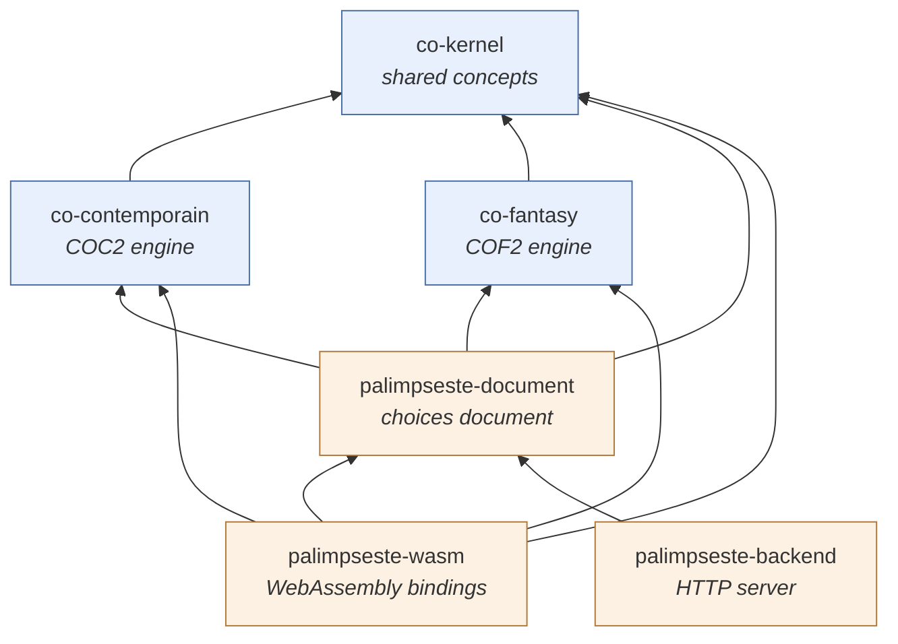
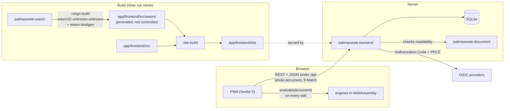

# Palimpseste

A companion application for the French tabletop role-playing game
*Chroniques Oubliées*, second edition: **COF2** (*Fantasy*) and **COC2**
(*Contemporain*).

> Palimpseste is a fan-made project, not affiliated with Black Book
> Éditions. See [NOTICE.md](NOTICE.md).

Palimpseste is a character editor. Later it will also track campaigns. It
guides a player through character creation step by step. It computes every
derived value with its breakdown (where each point comes from) and reports
every rule the character breaks. The Game Master can still override any
rule, through attributed waivers and manual adjustments.

Each ruleset is a **WorldEngine**: its rules are Rust code, built from
mechanics, and its game content is data in enums and `match` tables. The
engines are compiled to WebAssembly and run in the browser, so values and
violations are recomputed on every edit. The server signs users in and
stores their characters. It never applies a rule.

> **Current phase:** the shared kernel and both engines, COC2 (core rules:
> creation, then experience) and COF2 (core rules: creation at level 1,
> then the levels after it), served by a PWA and its backend. Users create
> and level up characters, follow them in play, and share them with their
> friends. Variants, combat resolution and campaigns are out of scope for
> now: see the [roadmap](#roadmap).

## Roadmap

What is done, and what is not started. Each unchecked item awaits its own
decision (the `Open` sections of [docs/adr/](docs/adr/README.md), the
out-of-scope lists of [AGENTS.md](AGENTS.md)); none is scheduled.

**Rules**

- [x] Kernel: characteristics, voies, derived values with breakdown,
  violations, waivers, adjustments, dice, rolls resolved from their
  faces, capacité effects
- [x] COC2 core rules: character creation
- [x] COC2 core rules: experience (XP spendings, social class, rank 5
  characteristic growth, dé bonus target, sequels acquired in play)
- [x] COF2 core rules: character creation at level 1
- [x] COF2 core rules: levels (capacités acquired and forgotten,
  reorientation, orphan point)
- [x] Every capacité of both engines lists its effects; test bonuses,
  situational modifiers and equipment in play
- [ ] Every capacité effect computed: see [Capacité coverage](#capacité-coverage)
- [ ] Lasting effects: COF2 mutilations, COC2 psychic sequels and
  traumatismes, aging
- [ ] Combat resolution, weapon range, armes de prédilection
- [ ] Variants (COC2 3d6, ...) and universe rules (échelle d'évolution)
- [ ] COF2 hybrid profils, PV per level, prestige voies
- [ ] Money: prices, purchases, the COC2 era
- [ ] Dice rolling

**Application**

- [x] Choices document, versioned, and the WebAssembly bindings
- [x] Backend: OIDC sign-in and sign-up, sessions, users and linked
  identities, characters stored with optimistic concurrency, health check
- [x] Friends, through single-use invitation links, who read each other's
  characters
- [x] PWA: the character editor, step by step, with waivers and adjustments
- [x] PWA: level-ups (COF2) and XP spendings (COC2) prepared as drafts and
  validated whole
- [x] PWA: the character sheet for play: effects of each capacité,
  situational modifiers, resources counted, equipment in play, screen kept
  on
- [x] PWA: installable, with a theme per device, and end-to-end tests
- [x] Container image, Fly.io deployment, CI with coverage
- [ ] Offline editing: documents kept on the device and synced
- [ ] Narrative steps beyond the character name
- [ ] Play state (resources) saved beyond the device
- [ ] Choosing which characters friends see, blocking, unlinking identities
- [ ] Campaign tracker: campaigns, parties, roles, and the Game Master's
  authority over waivers

## Capacité coverage

Every capacité of both engines lists its effects, in short French texts of
our own (ADR ENG-ABILITY-EFFECTS). An effect is **computed** when the
engine counts it in a total of the sheet. A described effect that gives a
test bonus or a dé bonus **shows its amount**. Any other effect is only
**described**: the sheet shows it and the player applies it.

| | COF2 | COC2 |
|---|---:|---:|
| Voies | 78 | 18 |
| Capacités | 390 | 90 |
| every effect computed or showing its amount | 52 (13 %) | 39 (43 %) |
| some effects computed or showing an amount | 87 (22 %) | 39 (43 %) |
| effects only described | 251 (64 %) | 12 (13 %) |
| Effects | 569 | 179 |
| computed | 102 (18 %) | 33 (18 %) |
| showing an amount | 90 (16 %) | 75 (42 %) |
| only described | 377 (66 %) | 71 (40 %) |

Percentages are rounded. A described effect can still reach the sheet as a
situational modifier, listed apart from the totals; the table does not
count those. A test in each engine (`the_readme_reports_this_coverage`, in
its `ability_effects.rs`) holds these numbers: when it fails, update the
table. Moving the described effects to computed is the unchecked roadmap
item above.

## Principles

1. **The Game Master can override every rule.** Breaking a rule is always
   possible, and never easier than following it.
2. **Types encode structure, not game bounds.** Out-of-bound values can be
   represented, and they produce violations.
3. **Violations and derived values are computed, never stored.** Only
   choices, adjustments and waivers are stored.
4. **Deviations are explicit.** A deviation is accepted only through a
   waiver, which someone grants by hand, with their name and a reason, on
   that one violation. Nothing waives a rule implicitly, and every waiver
   stays visible on the character. An adjustment always shows up as a
   notice.
5. **Rules are code.** There is no rules engine, no expression language and
   no configuration-driven behaviour.

The full list, the scope of each part and the coding conventions are in
[AGENTS.md](AGENTS.md).

## Repository layout

```
Cargo.toml                 virtual Cargo workspace
mise.toml                  tool versions and tasks
.clippy.toml               lint configuration
Dockerfile, fly.toml       container image and Fly.io deployment
.github/workflows/         CI (checks, coverage sent to Codecov: codecov.yml)
AGENTS.md                  scope, principles and conventions (CLAUDE.md links to it)
docs/adr/                  architecture decisions, one document per area
.claude/skills/            backend-structure
.claude/agents/            Rust review agents
crates/                    the rules: no I/O, no async code, no serde
├── co-kernel/             concepts shared by every engine
├── co-contemporain/       COC2 engine: creation and experience
└── co-fantasy/            COF2 engine: creation at level 1 and levels
app/                       the applications
├── document/              palimpseste-document: the choices document
├── wasm/                  palimpseste-wasm: the engines for the browser
├── backend/               palimpseste-backend: HTTP server, sign-in, storage
└── frontend/              the PWA (pnpm package, outside the Cargo workspace)
```

The rules live under `crates/` and the applications under `app/`
(ADR APP-LAYOUT).

## Crates and packages

### `crates/co-kernel`: the kernel

The concepts that mean exactly the same thing in every engine, and nothing
else:

- **Characteristics**: `AGI`, `CON`, `FOR`, `PER`, `CHA`, `INT`, `VOL`,
  their abbreviations, values and modifiers.
- **Voies**: ranks, voie and ability identifiers, and the checks every
  voie shares on the ranks acquired in it. Structure only, with no cost or
  budget rule.
- **Items**: the name of a free text item and a quantity carried.
- **Capacité effects** (`AbilityEffect`): what a capacité does, as a short
  text with its quantities as formulas, computed by the engine or only
  described; and **specialities**, the free text a capacité asks the player
  to choose.
- **Derived values** (`DerivedValue`): a total together with the
  contributions that produced it.
- **Adjustments**: manual contributions, attributed to an author.
- **Violations**: computed findings with a stable rule identifier, the
  emitting mechanic, a subject, parameters and a category (`Incomplete`,
  `Deviation` with a `Severity`, `Uncomputable`, `Notice`).
- **Waivers and `ViolationReport`**: attributed acceptance of a deviation,
  and the matching of violations against waivers.
- **Dice** (`Dice`, `Die`): described, never drawn.
- **Rolls** (`Rolled`, `RollMode`, `TestRoll`): a test's dice resolved from
  the faces drawn elsewhere.

It has no dependencies. Decisions: [docs/adr/kernel.md](docs/adr/kernel.md).

### `crates/co-contemporain`: the COC2 engine

Character creation, and the experience spent after it, under the core
rules of *Chroniques Oubliées Contemporain*:

- **Choices**: age and age bracket, domaine, voie ranks, traits distinctifs,
  characteristic points, weapons and items carried, protections worn.
- **Content**: the 18 domaines, the 18 voies, traits and sequels, the
  age-bracket limits, and the weapon and protection tables.
- **Rules**: characteristic and capacity budgets, maximum voies and ranks,
  trait balance, characteristic bounds, social class, starting equipment.
- **Secondary characteristics**: Init, DEF, ATC/ATD, CG, health scale,
  protection RD and malus, weapon damage, critical range.
- **Experience**: XP earned and each spending (ranks, traits, social
  class), the characteristic each rank 5 raises, the capacité a dé bonus
  goes to, sequels acquired in play.
- **Capacités**: the effects of the 90 capacités, test bonuses (with their
  dé bonus), situational modifiers, and the equipment in play.
- **Rolls**: what a characteristic test, an attack test or a weapon's DM
  offers (base, options to pick, critical range, help) and its resolution
  from the dice rolled, line by line; never success or failure.

Decisions: [docs/adr/engines.md](docs/adr/engines.md).

### `crates/co-fantasy`: the COF2 engine

Character creation at level 1, and the capacités acquired at each level
after it, under the core rules of *Chroniques Oubliées Fantasy*:

- **Choices**: profil (and its family), peuple, value series and how it is
  assigned, peuple bonus and malus, voie ranks, armour and shield, items
  carried, purse.
- **Content**: the 4 families, the 14 profils, the 8 peuples, the 3 value
  series, the 78 voies reachable at level 1, the armour, shield and weapon
  tables, and the currency.
- **Rules**: series assignment, peuple modifiers, characteristic bounds,
  profil voies and voie de peuple, level required per rank, armour limits,
  starting equipment and purse, and more.
- **Levels**: the capacités acquired and forgotten at each level-up, the
  orphan point, the level reached and its dé évolutif.
- **Derived values**: PV, DR, PC, PM, Init, DEF, contact, ranged and magic
  attacks, weapon damage, critical range, money held, spells.
- **Capacités**: the effects of the 390 capacités, the options chosen per
  capacité, test bonuses (with their dé bonus), situational modifiers, and
  the equipment in play.
- **Rolls**: what a characteristic test, an attack test or a weapon's DM
  offers and its resolution from the dice rolled, with one competence
  bonus per source capped at +15, the help of allies and a critical DM
  doubled; never success or failure.

Both engines expose a catalogue of their content (`ALL`, `id()`,
`from_id()`, `name()`) and the creation steps (`Step`), in the book's
order, with each violation placed in one step (ADR ENG-CATALOGUE,
ADR ENG-STEPS).

### `app/document`: `palimpseste-document`

The **choices document**: a versioned `serde` document, tagged by engine
(`contemporain`, `fantasy`). It holds the choices, the adjustments and the
waivers, and names content by the engines' string identifiers
(`cof.weapon.epee-longue`). It also holds the level-ups (COF2), the XP spendings (COC2) and the
specialities. It converts one way, into an engine `Character`, and
that conversion is also the check that the document is readable
(ADR APP-DOCUMENT, ADR APP-READABLE). The browser and the server share
this crate. Its TypeScript derives (`tsify`) are behind the `ts` feature,
which only `palimpseste-wasm` enables.

### `app/wasm`: `palimpseste-wasm`

The engines compiled to WebAssembly. It exposes six stateless functions
over plain data: `emptyDocument(engine)`, `catalog(engine)`,
`evaluate(document)`, `evaluateInPlay(document, equipment)`,
`rollOffer(document, play, roll)` and `roll(document, play, request)`.
`evaluate` returns values with their breakdowns, violations by step, the
status of each step, each capacité's effects written for the character,
its situational modifiers and the roll of each line; `evaluateInPlay`
computes the same with the equipment carried in play; `rollOffer` says
what a roll offers, and `roll` draws the dice and returns every line of
the total. No Rust object crosses the
boundary (ADR APP-BINDINGS). `mise run wasm:build` writes the bindings into
`app/frontend/src/wasm/`. They are generated, never committed.

### `app/backend`: `palimpseste-backend`

The HTTP server (axum, tokio), which:

- serves the built PWA, with hashed `/assets/` files cached as immutable;
- signs users in through any number of OIDC providers, with server-side
  sessions;
- creates an account at the first sign-in, and keeps each user's nickname,
  profile and linked identities;
- makes friends of users through single-use invitation links, who then
  read each other's characters, never changing them;
- stores characters in SQLite (`rusqlite`). A document is replaced whole
  with `If-Match`, and is checked only for readability, never for
  violations;
- answers `/healthz`, which returns `200` while the database answers.

The routes are under `/api`: `/api/auth/*`, `/api/me`,
`/api/me/identities`, `/api/me/characters`, `/api/characters/{id}`,
`/api/characters/{id}/document`, `/api/me/invitations`,
`/api/invitations/lookup` and `/api/me/friends`. Decisions:
[docs/adr/backend.md](docs/adr/backend.md). Layout guide:
[backend-structure skill](.claude/skills/backend-structure/SKILL.md).

### `app/frontend`: the PWA

TypeScript and Svelte 5 (runes), built with Vite and `vite-plugin-pwa`.
Plain Svelte, not SvelteKit. Users sign in and out, create their account,
edit their profile and link identities, and list and create characters. A
character is edited step by step on its own page (`/characters/{id}`),
with waivers and adjustments, and the whole document is saved at once. Once
it is complete, it is levelled up (COF2) or spends its XP (COC2), each
entry prepared as a draft on the device and saved when validated. Its
sheet (`/characters/{id}/sheet`) is for play: each capacité's effects,
situational modifiers, resources counted and equipment in play kept on the
device, the screen kept on. Friends are made through invitation links, and
read each other's sheets. The theme is chosen per device. The rules run
locally through the WebAssembly bindings. Tests use Vitest, happy-dom and
Testing Library, and sit next to the code; end-to-end tests use Playwright
and a mock OIDC provider. Decisions:
[docs/adr/frontend.md](docs/adr/frontend.md).

## Dependencies between the crates

Cargo dependencies, with each arrow pointing from a crate to a crate it
depends on. The kernel comes first; every crate above it only adds to the
crates below.



The build order follows from it:

| Order | Crates | Depends on |
|---|---|---|
| 1 | `co-kernel` | nothing |
| 2 | `co-contemporain`, `co-fantasy` | `co-kernel` |
| 3 | `palimpseste-document` | the kernel and both engines |
| 4 | `palimpseste-wasm` (with `ts`), `palimpseste-backend` | `palimpseste-document` (and, for the bindings, the engines) |

The two engines never depend on each other. Only the crates under `app/`
use `serde`, and only the backend uses `tokio` (ADR APP-BOUNDARIES).

### From the crates to the running application

How the pieces are built and how they talk at runtime: the rules run in the
browser, and the server only stores (ADR APP-LOCAL-RULES,
ADR APP-STORE-ONLY).



## Getting started

Tool versions (Rust, Node, pnpm, cargo-nextest, wasm-bindgen-cli, ...) and
tasks are managed by [mise](https://mise.jdx.dev).

```sh
mise install          # install the tools
mise run check        # fmt, lint, test (nextest), doc-test
mise run serve        # build the PWA and serve it with the API on http://127.0.0.1:3000
mise run frontend:dev # Vite dev server proxying /api (run `mise run serve` alongside)
```

Other tasks: `fmt`, `lint`, `test`, `doc-test`, `coverage`, `wasm:build`,
`frontend:check`, `frontend:test`, `frontend:build`, `frontend:e2e`. Run
`mise tasks` for the full list.

The server is configured by command-line flags or environment variables:

| Variable | Default | Meaning |
|---|---|---|
| `PALIMPSESTE_ADDR` | `127.0.0.1:3000` | address to listen on |
| `PALIMPSESTE_FRONTEND_DIR` | `app/frontend/dist` | the built front end |
| `PALIMPSESTE_DATABASE` | `palimpseste.sqlite3` | SQLite file, created if missing |
| `PALIMPSESTE_PUBLIC_URL` | `http://127.0.0.1:3000` | base of the OIDC redirect URIs; `https` makes cookies `Secure` |
| `PALIMPSESTE_OIDC_PROVIDERS` | | comma-separated provider ids |
| `PALIMPSESTE_OIDC_<ID>_NAME`, `_ISSUER`, `_CLIENT_ID`, `_CLIENT_SECRET`, `_SCOPES` | | each provider's settings |

Put local secrets in an untracked `mise.local.toml`, never in `mise.toml`.
For deployment, the [Dockerfile](Dockerfile) builds the server and the PWA
into one image, and [fly.toml](fly.toml) runs it on Fly.io: one machine,
with its SQLite database on a volume.

## Documentation

- The developer README of each part:
  [co-kernel](crates/co-kernel/README.md),
  [co-contemporain](crates/co-contemporain/README.md),
  [co-fantasy](crates/co-fantasy/README.md),
  [palimpseste-document](app/document/README.md),
  [palimpseste-wasm](app/wasm/README.md),
  [palimpseste-backend](app/backend/README.md),
  [front end](app/frontend/README.md).
- [AGENTS.md](AGENTS.md): scope, design principles, Rust and front-end
  conventions, vocabulary (French game terms and their code names).
- [docs/adr/](docs/adr/README.md): architecture decisions by area
  (`KER-*`, `ENG-*`, `APP-*`, `BE-*`, `FE-*`), cited in the code as
  `ADR <ID>`.
- The co-rules skill: a normalised, paraphrased specification of the COF2
  and COC2 rules, with its rule interpretations (D-01, ...). It paraphrases
  copyrighted rulebooks, so it lives in a private repository and is not
  published; rule identifiers and `D-xx` numbers in the code refer to it.

## Licence

**Palimpseste is a fan-made project. It is not affiliated with Black Book
Éditions**, and it is not endorsed, sponsored or reviewed by Black Book
Éditions or the authors of *Chroniques Oubliées*.

Palimpseste's code and documentation are licensed under the
[GNU Affero General Public License v3.0 or later](LICENSE). The game rules,
names and data of *Chroniques Oubliées* belong to Black Book Éditions and
their authors and are not covered by this licence: see
[NOTICE.md](NOTICE.md).
