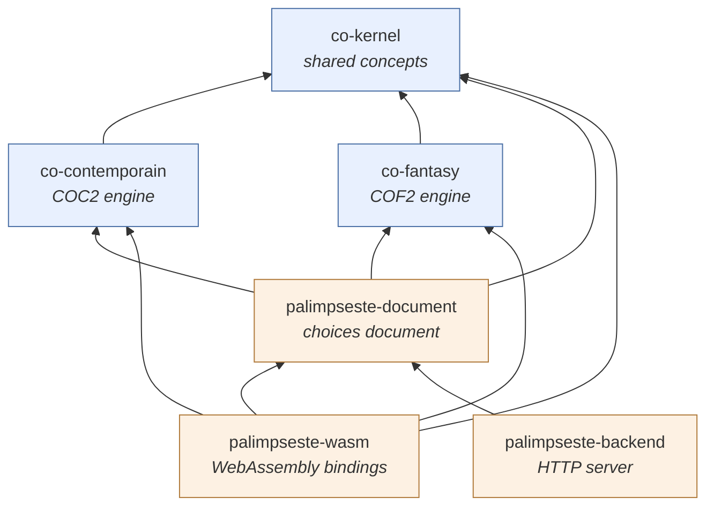
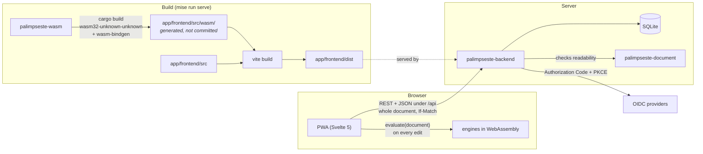

# Palimpseste

A companion application for the French tabletop role-playing game
*Chroniques Oubliées*, second edition: **COF2** (*Fantasy*) and **COC2**
(*Contemporain*).

Palimpseste is a character editor. Later it will also track campaigns. It
guides a player through character creation step by step. It computes every
derived value with its breakdown (where each point comes from) and reports
every rule the character breaks. The Game Master can still override any
rule, through attributed waivers and manual adjustments.

Each ruleset is a **WorldEngine**: its rules are Rust code, built from
mechanics, and its game content is data in enums and `match` tables. The
engines are compiled to WebAssembly and run in the browser, so values and
violations are recomputed on every edit. The server signs users in and
stores their characters. It never applies a rule.

> **Current phase:** the shared kernel, and character creation for COC2
> (core rules) and COF2 (core rules, level 1), served by a PWA and its
> backend. Variants, progression, combat and campaigns are out of scope for
> now.

## Principles

1. **The Game Master can override every rule.** Breaking a rule is always
   possible, and never easier than following it.
2. **Types encode structure, not game bounds.** Out-of-bound values can be
   represented, and they produce violations.
3. **Violations and derived values are computed, never stored.** Only
   choices, adjustments and waivers are stored.
4. **Deviations are explicit.** A deviation is accepted only through a
   waiver, and an adjustment always shows up as a notice.
5. **Rules are code.** There is no rules engine, no expression language and
   no configuration-driven behaviour.

The full list, the scope of each part and the coding conventions are in
[AGENTS.md](AGENTS.md).

## Repository layout

```
Cargo.toml                 virtual Cargo workspace
mise.toml                  tool versions and tasks
.clippy.toml               lint configuration
Dockerfile, fly.toml       container image and Fly.io deployment
AGENTS.md                  scope, principles and conventions (CLAUDE.md links to it)
docs/adr/                  architecture decisions, one document per area
.claude/skills/            backend-structure
.claude/agents/            Rust review agents
crates/                    the rules: no I/O, no async code, no serde
├── co-kernel/             concepts shared by every engine
├── co-contemporain/       COC2 engine: character creation
└── co-fantasy/            COF2 engine: character creation at level 1
app/                       the applications
├── document/              palimpseste-document: the choices document
├── wasm/                  palimpseste-wasm: the engines for the browser
├── backend/               palimpseste-backend: HTTP server, sign-in, storage
└── frontend/              the PWA (pnpm package, outside the Cargo workspace)
```

The rules live under `crates/` and the applications under `app/`
(ADR APP-LAYOUT).

## Crates and packages

### `crates/co-kernel`: the kernel

The concepts that mean exactly the same thing in every engine, and nothing
else:

- **Characteristics**: `AGI`, `CON`, `FOR`, `PER`, `CHA`, `INT`, `VOL`,
  their values and modifiers.
- **Voie skeleton**: voies, their ranks and the abilities attached to them.
  Structure only, with no cost or budget rule.
- **Derived values** (`DerivedValue`): a total together with the
  contributions that produced it.
- **Adjustments**: manual contributions, attributed to an author.
- **Violations**: computed findings with a stable rule identifier, the
  emitting mechanic, a subject, parameters and a category (`Incomplete`,
  `Deviation` with a `Severity`, `Uncomputable`, `Notice`).
- **Waivers and `ViolationReport`**: attributed acceptance of a deviation,
  and the matching of violations against waivers.
- **Dice** (`Dice`, `Die`): described, never rolled.

It has no dependencies. Decisions: [docs/adr/kernel.md](docs/adr/kernel.md).

### `crates/co-contemporain`: the COC2 engine

Character creation under the core rules of *Chroniques Oubliées
Contemporain*:

- **Choices**: age and age bracket, domaine, voie ranks, traits distinctifs,
  characteristic points, weapons and items carried, protections worn.
- **Content**: the 18 domaines, the 18 voies, traits and sequels, the
  age-bracket limits, and the weapon and protection tables.
- **Rules**: characteristic and capacity budgets, maximum voies and ranks,
  trait balance, characteristic bounds, social class, starting equipment.
- **Secondary characteristics**: Init, DEF, ATC/ATD, CG, health scale,
  protection RD and malus, weapon damage, critical range.

Decisions: [docs/adr/engines.md](docs/adr/engines.md).

### `crates/co-fantasy`: the COF2 engine

Character creation at level 1 under the core rules of *Chroniques Oubliées
Fantasy*:

- **Choices**: profil (and its family), peuple, value series and how it is
  assigned, peuple bonus and malus, voie ranks, armour and shield, items
  carried, purse.
- **Content**: the 4 families, the 14 profils, the 8 peuples, the 3 value
  series, the 78 voies reachable at level 1, the armour, shield and weapon
  tables, and the currency.
- **Rules**: series assignment, peuple modifiers, characteristic bounds,
  profil voies and voie de peuple, level required per rank, armour limits,
  starting equipment and purse, and more.
- **Derived values**: PV, DR, PC, PM, Init, DEF, contact, ranged and magic
  attacks, weapon damage, critical range, money held.

Both engines expose a catalogue of their content (`ALL`, `id()`,
`from_id()`, `name()`) and the creation steps (`Step`), in the book's
order, with each violation placed in one step (ADR ENG-CATALOGUE,
ADR ENG-STEPS).

### `app/document`: `palimpseste-document`

The **choices document**: a versioned `serde` document, tagged by engine
(`contemporain`, `fantasy`). It holds the choices, the adjustments and the
waivers, and names content by the engines' string identifiers
(`cof.weapon.epee-longue`). It converts one way, into an engine `Character`, and
that conversion is also the check that the document is readable
(ADR APP-DOCUMENT, ADR APP-READABLE). The browser and the server share
this crate. Its TypeScript derives (`tsify`) are behind the `ts` feature,
which only `palimpseste-wasm` enables.

### `app/wasm`: `palimpseste-wasm`

The engines compiled to WebAssembly. It exposes three stateless functions
over plain data: `emptyDocument(engine)`, `catalog(engine)` and
`evaluate(document)`. `evaluate` returns values with their breakdowns,
violations by step, and the status of each step. No Rust object crosses the
boundary (ADR APP-BINDINGS). `mise run wasm:build` writes the bindings into
`app/frontend/src/wasm/`. They are generated, never committed.

### `app/backend`: `palimpseste-backend`

The HTTP server (axum, tokio), which:

- serves the built PWA, with hashed `/assets/` files cached as immutable;
- signs users in through any number of OIDC providers, with server-side
  sessions;
- creates an account at the first sign-in, and keeps each user's nickname,
  profile and linked identities;
- stores characters in SQLite (`rusqlite`). A document is replaced whole
  with `If-Match`, and is checked only for readability, never for
  violations;
- answers `/healthz`, which returns `200` while the database answers.

The routes are under `/api`: `/api/auth/*`, `/api/me`,
`/api/me/identities`, `/api/me/characters`, `/api/characters/{id}` and
`/api/characters/{id}/document`. Decisions:
[docs/adr/backend.md](docs/adr/backend.md). Layout guide:
[backend-structure skill](.claude/skills/backend-structure/SKILL.md).

### `app/frontend`: the PWA

TypeScript and Svelte 5 (runes), built with Vite and `vite-plugin-pwa`.
Plain Svelte, not SvelteKit. Users sign in and out, create their account,
edit their profile and link identities, and list and create characters. A
character is edited step by step on its own page (`/characters/{id}`),
with waivers and adjustments, and the whole document is saved at once. The
rules run locally through the WebAssembly bindings. Tests use Vitest, jsdom
and Testing Library, and sit next to the code. Decisions:
[docs/adr/frontend.md](docs/adr/frontend.md).

## Dependencies between the crates

Cargo dependencies, with each arrow pointing from a crate to a crate it
depends on. The kernel comes first; every crate above it only adds to the
crates below.



The build order follows from it:

| Order | Crates | Depends on |
|---|---|---|
| 1 | `co-kernel` | nothing |
| 2 | `co-contemporain`, `co-fantasy` | `co-kernel` |
| 3 | `palimpseste-document` | the kernel and both engines |
| 4 | `palimpseste-wasm` (with `ts`), `palimpseste-backend` | `palimpseste-document` (and, for the bindings, the engines) |

The two engines never depend on each other. Only the crates under `app/`
use `serde`, and only the backend uses `tokio` (ADR APP-BOUNDARIES).

### From the crates to the running application

How the pieces are built and how they talk at runtime: the rules run in the
browser, and the server only stores (ADR APP-LOCAL-RULES,
ADR APP-STORE-ONLY).



## Getting started

Tool versions (Rust, Node, pnpm, cargo-nextest, wasm-bindgen-cli, ...) and
tasks are managed by [mise](https://mise.jdx.dev).

```sh
mise install          # install the tools
mise run check        # fmt, lint, test (nextest), doc-test
mise run serve        # build the PWA and serve it with the API on http://127.0.0.1:3000
mise run frontend:dev # Vite dev server proxying /api (run `mise run serve` alongside)
```

Other tasks: `fmt`, `lint`, `test`, `doc-test`, `coverage`, `wasm:build`,
`frontend:check`, `frontend:test`, `frontend:build`. Run `mise tasks` for
the full list.

The server is configured by command-line flags or environment variables:

| Variable | Default | Meaning |
|---|---|---|
| `PALIMPSESTE_ADDR` | `127.0.0.1:3000` | address to listen on |
| `PALIMPSESTE_FRONTEND_DIR` | `app/frontend/dist` | the built front end |
| `PALIMPSESTE_DATABASE` | `palimpseste.sqlite3` | SQLite file, created if missing |
| `PALIMPSESTE_PUBLIC_URL` | `http://127.0.0.1:3000` | base of the OIDC redirect URIs; `https` makes cookies `Secure` |
| `PALIMPSESTE_OIDC_PROVIDERS` | | comma-separated provider ids |
| `PALIMPSESTE_OIDC_<ID>_NAME`, `_ISSUER`, `_CLIENT_ID`, `_CLIENT_SECRET`, `_SCOPES` | | each provider's settings |

Put local secrets in an untracked `mise.local.toml`, never in `mise.toml`.
For deployment, the [Dockerfile](Dockerfile) builds the server and the PWA
into one image, and [fly.toml](fly.toml) runs it on Fly.io: one machine,
with its SQLite database on a volume.

## Documentation

- The developer README of each part:
  [co-kernel](crates/co-kernel/README.md),
  [co-contemporain](crates/co-contemporain/README.md),
  [co-fantasy](crates/co-fantasy/README.md),
  [palimpseste-document](app/document/README.md),
  [palimpseste-wasm](app/wasm/README.md),
  [palimpseste-backend](app/backend/README.md),
  [front end](app/frontend/README.md).
- [AGENTS.md](AGENTS.md): scope, design principles, Rust and front-end
  conventions, vocabulary (French game terms and their code names).
- [docs/adr/](docs/adr/README.md): architecture decisions by area
  (`KER-*`, `ENG-*`, `APP-*`, `BE-*`, `FE-*`), cited in the code as
  `ADR <ID>`.
- The co-rules skill: a normalised, paraphrased specification of the COF2
  and COC2 rules, with its rule interpretations (D-01, ...). It paraphrases
  copyrighted rulebooks, so it lives in a private repository and is not
  published; rule identifiers and `D-xx` numbers in the code refer to it.
